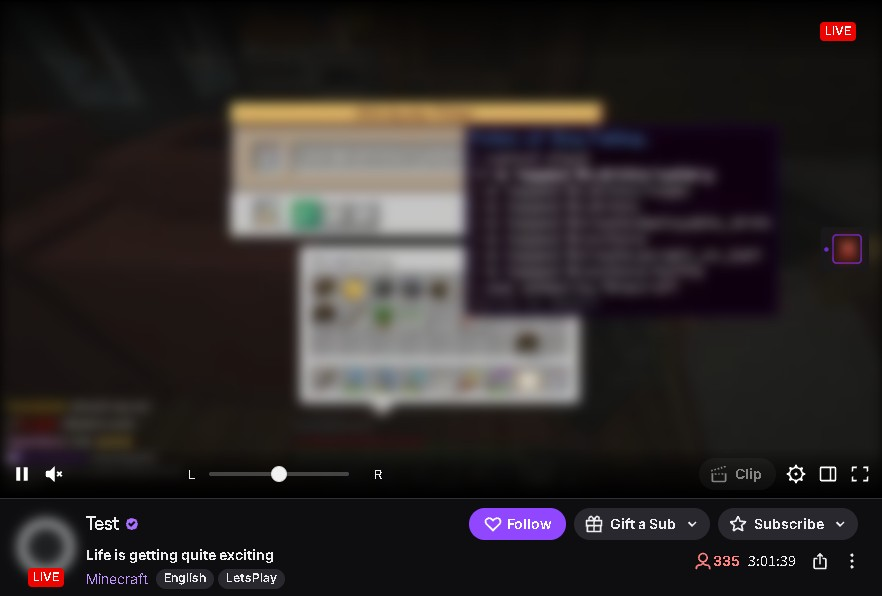
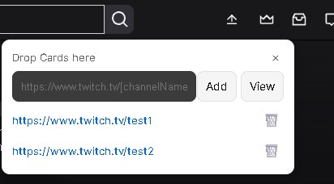
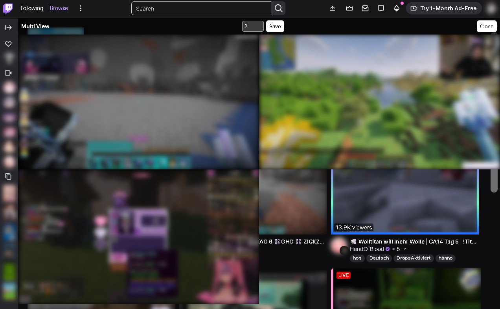

# 概要
このユーザースクリプトは、Twitch（twitch.tv）で `音声割り振り（L・R）`と`multi view` を実装します。

# 機能
1. **Pan**
   - 音声をチャンネルごとに左右に割り振ることができます。
2. **Multi view**
   - アップロードアイコンにカードを`ドラッグ＆ドロップ`するか`チャンネル名を入力`してviewボタンをクリックすると複窓で視聴できるようになります。
# インストール
1. **Tampermonkey をインストールする**  
   - Chrome : [Tampermonkey](https://chromewebstore.google.com/detail/tampermonkey-%E3%83%99%E3%83%BC%E3%82%BF%E7%89%88/gcalenpjmijncebpfijmoaglllgpjagf)
   - Firefox : [Tampermonkey](https://addons.mozilla.org/ja/firefox/addon/tampermonkey/)

2. **ユーザースクリプトを許可する**  
   拡張機能の管理で「ユーザースクリプトを許可」してください。詳しくは公式 [FAQ](https://www.tampermonkey.net/faq.php?locale=ja&q=Q209) を参照してください。  

3. **youtube-ufret-chords-usersciprt をインストール**    
   [ここ](https://github.com/grmpnk/Twitch-pan-and-multiview/raw/refs/heads/main/userscript.user.js) から インストールできます。
